# StockViz UI audit, round 2 (Liquid Chrome)

27 Nov 2026 · `dev` @ `0909e55` · 47 screens (6 public, 41 signed in) at 390 and 1440 px · seeded demo data, closes to 7 Apr 2025.

This is the audit: where the app stands and why. **What to build is in [`../redesign/README.md`](../redesign/README.md)**, one card per change, in build order. The full illustrated report, with every screen, before/after sliders and the research, is the artifact "StockViz PRISM Audit" (https://claude.ai/artifact/SC4gfUQ1sfxE7vi9WLL4YR, private to the owner until shared).

It merges two audits done the same day (the whole app, and a deeper pass on the signed-in pages), so the numbers here, the build list and the artifacts agree. No code was changed.

## Decisions that hold

- **Palette: Liquid Chrome**, as on `dev` and `main`. Ink `#070708`, pearl `#f2eee6`, champagne brand `#dcc49a` for identity, focus and selection only, metal gradient steel `#8d9bb0` → champagne `#f0dfba` → silver `#d6dbe2`, gain `#3ee59a`, loss `#ff6b7f`. Violet, Volt and Solar were tried and set aside; no other palette is proposed.
- **Landing page stays** as it is, except the "Everything in the workspace" section (L1).
- **Labels in Title Case** via `titleCase()`, never capitals. Status is a shape and a word, never colour alone.
- **Sidebar:** 38 links in total (36 pages in six workspaces, plus Settings and Status). The redesign folds workspaces; it does not add pinned pages.

## Score

Nielsen's ten heuristics, 0 to 4 each, out of 40, per group of pages that share a template. One reviewer's judgement, not user testing.

| Whole app | Round 1 start | Dev today | With this redesign |
|---|---:|---:|---:|
| Average of page groups | 30 | 29 | 36 |

| Group | Pages | Now | Target | What holds it back |
|---|---|---:|---:|---|
| Shell and sidebar | `every signed-in page` | 26 | 36 | 36 pages always open, items share icons (C1); top bar chips say Unknown (C5) |
| Landing | `/` | 35 | 38 | Terrain sentence over the mesh (C9); workspace tiles scroll sideways (L1) |
| Dashboard | `/dashboard` | 30 | 36 | Hero shows two figures (C17); line exaggerates a quiet month (C7); missing space (C12) |
| Morning Brief | `/brief` | 25 | 35 | Counts hidden in one line; dates repeated per row (C16) |
| Markets | `/markets` | 26 | 35 | 136 of 161 rows are dashes, 8,525 px tall (C15) |
| Checklist | `/checklist` | 21 | 35 | 966 repeated labels, 17,167 px tall (C14) |
| Screener | `/screener` | 28 | 37 | Rule builder hidden (C8); 5 px past a phone (C18) |
| Stock and tearsheet | `/stocks/AAPL` | 33 | 36 | Sidebar (C1) |
| Trade, Orders, History | `/trade …` | 33 | 36 | Sidebar (C1) |
| Portfolio | `/portfolio …` | 32 | 36 | Import, tax and journal open empty (C3) |
| Watchlist, Alerts, Notifications | `/watchlist …` | 32 | 36 | Notifications has two homes (C19); half-width forms (C4) |
| Charts and Compare | `/charts, /compare` | 31 | 35 | Compare in blue and violet (C10); half-width (C4) |
| Backtest family | `/backtest …` | 29 | 36 | Two rows of tabs (C6); native dates (C11); runs open empty (C3) |
| First-use research tools | `/pairs, /optimise …` | 24 | 36 | Open on a blank box with no example (C3, C4) |
| AI Copilot | `/copilot` | 21 | 35 | Tells users to set a server variable (C2) |
| Data-dependent pages | `/india-options, /macro, /filings` | 23 | 34 | Raw Markdown and CLI commands shown to users (C2) |
| Settings and Status | `/settings, /status` | 31 | 35 | Below the fold in the sidebar (C1) |
| Docs, Sign in, Sign up | `/docs, /login` | 33 | 36 | Small polish only |

No P0: no wrong number was found. Already good and kept: the chrome identity, the market terrain, every price dated, two-step order review, the ⌘K palette, cards under `md`, and empty states that never invent a figure.

## Findings

P1 major, P2 minor, P3 polish. Effort S is under a day, M a few days. The redesign card that closes each one is in brackets.

| # | Severity | Effort | Finding | Closed by |
|---|---|---|---|---|
| C1 | P1 | M | The sidebar no longer fits the screen | M1 |
| C2 | P1 | S | Developer instructions are shown to users | M3, M6 |
| C3 | P1 | M | Half the new pages open empty | M2 |
| C4 | P2 | M | Form pages use half the screen | M2, M3, M6 |
| C5 | P2 | S | The top bar has eight controls and two say "Unknown" | M1 |
| C6 | P2 | S | Two rows of tabs on Quant Lab pages | C6 |
| C7 | P2 | S | A quiet month looks like a crash | C7 |
| C8 | P2 | M | The screener hides its best tool | M4 |
| C9 | P2 | S | The terrain sentence sits on the mesh | C9 |
| C13 | P2 | M | Phone has no quick way between workspaces | M5 |
| C10 | P3 | S | Compare is the only blue and violet in the app | C10 |
| C11 | P3 | S | Native date fields everywhere | C11 |
| C12 | P3 | S | A missing space on the dashboard | C12 |
| C14 | P1 | M | Checklist repeats 966 labels and is 17,167 px tall | C14 |
| C15 | P1 | S | Markets is mostly rows of dashes | C15 |
| C16 | P2 | S | Morning Brief wastes half the screen | C16 |
| C17 | P2 | S | Dashboard hero shows only two figures | C17 |
| C18 | P2 | S | Screener runs 5 px off a phone | C18 |
| C19 | P2 | S | Notifications has two homes | C19 |
| C20 | P3 | S | Trade appears twice in the dashboard shortcuts | left as is |

### C1 · The sidebar no longer fits the screen

P1 · effort M · `components/app-navigation.tsx, components/navigation-icons.ts, components/app-sidebar.tsx, lib/app-navigation.ts`

**Evidence.** 36 pages under six workspace headings are always open. At 1440 × 900 the list stops at "Experiments"; Portfolio & Tax, AI Copilot, Status and Settings are below the fold. Four items have no icon (Experiments, Pairs lab, Import tradebook, Theses) and three pairs share one (Markets and Macro, Charts and Desks, India options and News reactions).

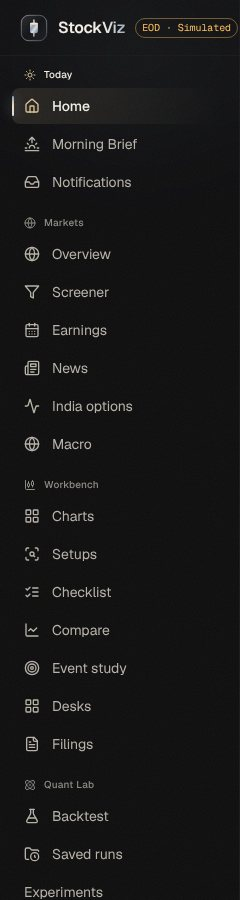

*Sidebar at 1440 × 900 on /dashboard.*

**Fix.** Workspace headings fold to a count; Today and the current workspace stay open; every item gets its own icon; a small Market Pulse card sits at the foot (mockup M1).

### C2 · Developer instructions are shown to users

P1 · effort S · `components/fo-india-view.tsx:122-123, app/(product)/copilot/page.tsx, components/macro-view.tsx`

**Evidence.** India options prints the API module docstring as text, with raw Markdown (`**ATM IV:**`, ```SKEW_OFFSET```) and a CLI command. Copilot says "set OLLAMA_MODEL". Macro and the Checklist name `stockviz.cli` commands.

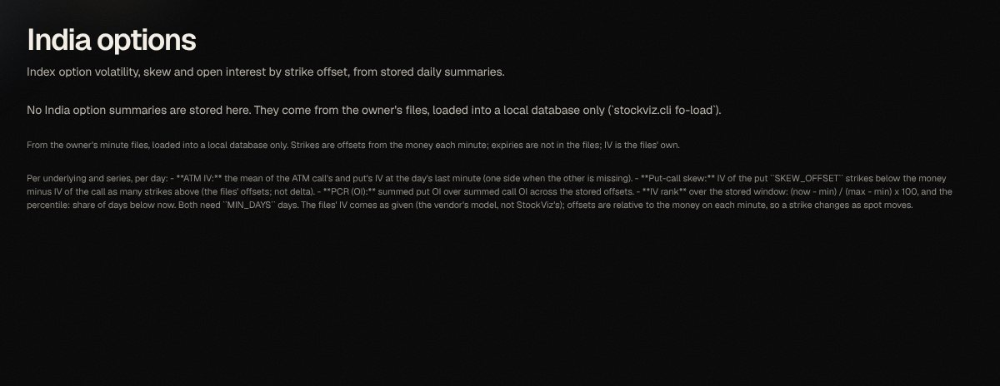

*/india-options at 1440 px: the method text is the docstring of services/fo/summary.py.*

**Fix.** A one-sentence user message plus a closed "For the server owner" disclosure for the command (mockups M3, M6). Render the method note as a lead line and a definition list, with Markdown stripped.

### C3 · Half the new pages open empty

P1 · effort M · `one shared FirstRun component, then each page`

**Evidence.** 20 of 41 signed-in pages open on a dashed box with one sentence (filter "Empty first" in the gallery). None shows what the result will look like, and only some offer a starting example.

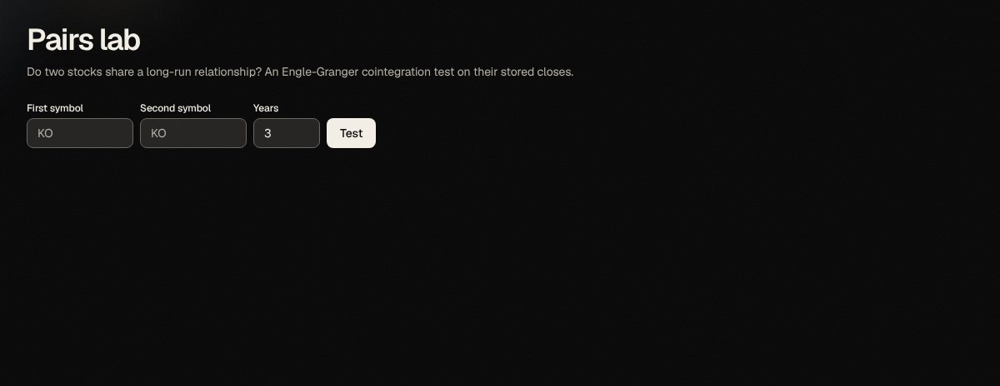

*/pairs: two blank fields and a Test button.*

**Fix.** Every first-use page gets a one-click example built from real symbols, a preview of the result, and a list of past runs (mockup M2).

### C4 · Form pages use half the screen

P2 · effort M · `the same pages`

**Evidence.** On Copilot, Classroom, Pairs lab, Theses, Filings, Notifications, Desks, Compare and Backtest the content stops near the middle; a third or more of a 1440 px screen is empty.

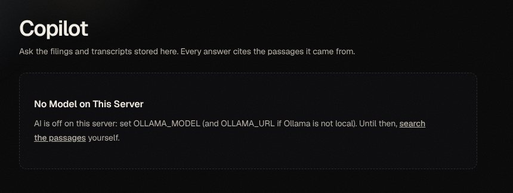

*/copilot: one box, the rest of the page empty.*

**Fix.** Two columns: the form on the left, and on the right something useful from data the page already has: recent items, the method or help text now under the form, or a live preview (M2, M3, M6). Desks, Compare and Backtest each need a short design pass first.

### C5 · The top bar has eight controls and two say "Unknown"

P2 · effort S · `components/regime-popover.tsx:43, components/regime-badge.tsx, components/app-shell.tsx`

**Evidence.** Search, data date, sound (four dots, no word), US regime "Unknown", India regime "Unknown", book, bell, avatar. "Unknown" reads like an error.


*Top bar on every workspace page.*

**Fix.** Show a regime chip only for a market whose regime is known, and nothing when both are unknown; give sound a speaker icon with its name in the tooltip; keep book, bell and avatar (M1).

### C6 · Two rows of tabs on Quant Lab pages

P2 · effort S · `components/research-page-header.tsx:27`

**Evidence.** Backtest shows nine workspace tabs (Backtest, Saved runs … News reactions) above its own three mode tabs. The nine repeat the sidebar.

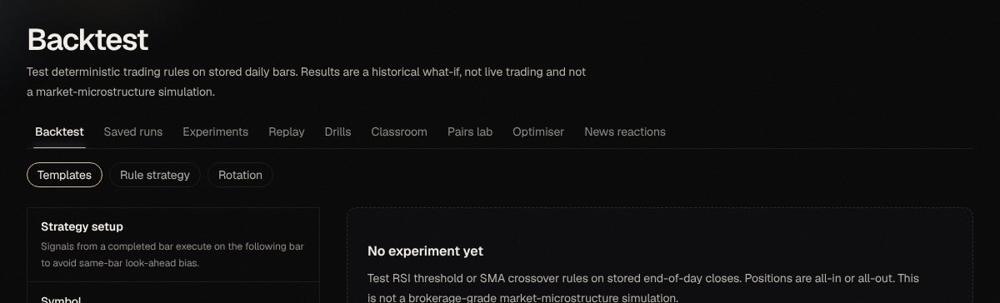

*/backtest at 1440 px.*

**Fix.** Hide the workspace subnav from `lg` up, where the sidebar shows the same links; keep it on phone and tablet.

### C7 · A quiet month looks like a crash

P2 · effort S · `components/dashboard/nav-sparkline.tsx`

**Evidence.** The dashboard line spans its full height for a −0.46% month, with no axis or baseline, so a 0.5% wobble reads as a collapse.

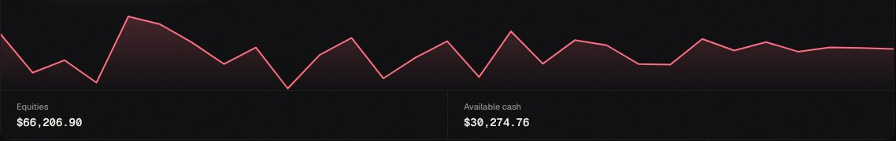

*Dashboard hero line, 30 days, −$468.71.*

**Fix.** Draw a baseline at the starting value, give the range at least ±2%, and label the first and last value.

### C8 · The screener hides its best tool

P2 · effort M · `app/(product)/screener/page.tsx and the rule builder`

**Evidence.** The visual rule builder is closed under "Build visually"; an empty rule textbox comes first; filter groups look like headings with no chevron; there are two separate "Name this …" save fields.

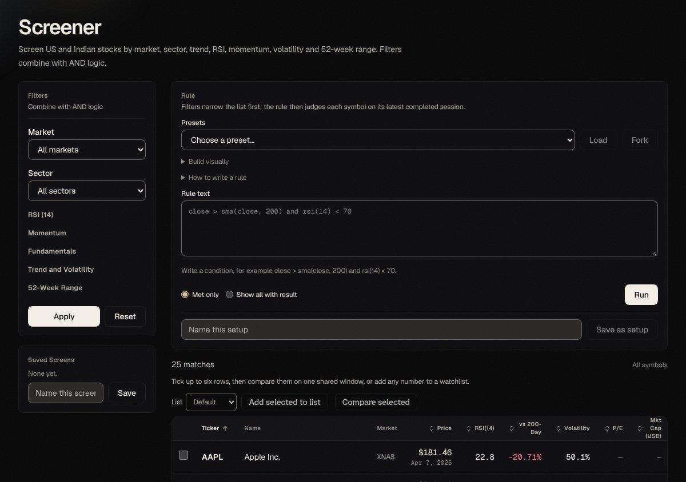

*/screener at 1440 px.*

**Fix.** Filters as removable chips, the rule built from chip rows with a live sentence and match count, one Save menu (mockup M4).

### C9 · The terrain sentence sits on the mesh

P2 · effort S · `components/prism/terrain-section.tsx`

**Evidence.** The landing sentence "On Apr 7, 2025, 5 of 25 were above where they started" is drawn straight over bright wireframe peaks.

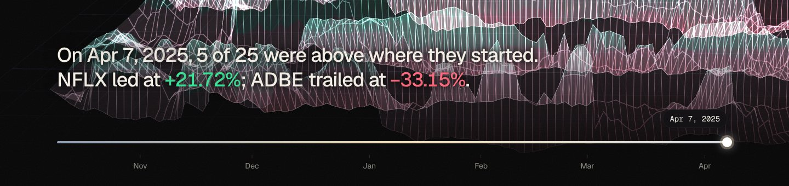

*Landing, "fourth axis" section.*

**Fix.** Fade the canvas behind the text band with `mask-image` on the host (overlays break the WebGL layer), or move the sentence under the canvas.

### C13 · Phone has no quick way between workspaces

P2 · effort M · `components/app-mobile-nav.tsx`

**Evidence.** Every move on a phone goes through the menu button and the same 38-link list.

**Fix.** A five-tab bar (Today, Markets, Workbench, Portfolio, More) with More as a sheet of the remaining pages (mockup M5).

### C10 · Compare is the only blue and violet in the app

P3 · effort S · `lib/chart-theme.ts:52`

**Evidence.** The AAPL and MSFT lines and their tags use the categorical overlay ramp `#8277e8, #4baebd …`.

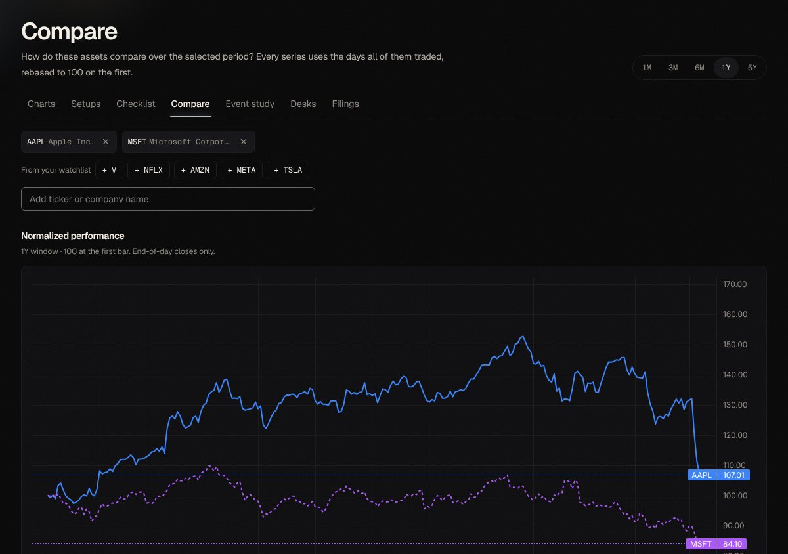

*/compare?tickers=AAPL&tickers=MSFT.*

**Fix.** Chrome series: pearl, champagne, steel, with the existing dash styles carrying the difference.

### C11 · Native date fields everywhere

P3 · effort S · `the four forms`

**Evidence.** Replay, Event study, News and Backtest use the browser's mm/dd/yyyy field, which looks different on every browser.

**Fix.** Range chips (1Y, 3Y, since 2020, custom) with one styled date field for custom.

### C12 · A missing space on the dashboard

P3 · effort S · `components/dashboard/news-widget.tsx:42`

**Evidence.** The news tile reads "…watchlist yet.Market headlines".

**Fix.** Add the space before the link.

### C14 · Checklist repeats 966 labels and is 17,167 px tall

P1 · effort M · `app/(product)/checklist/page.tsx, components/checklist/checklist-view.tsx`

**Evidence.** 161 cards each write out all six dimension names. The page is 17,167 px on desktop and 34,816 px on a phone.

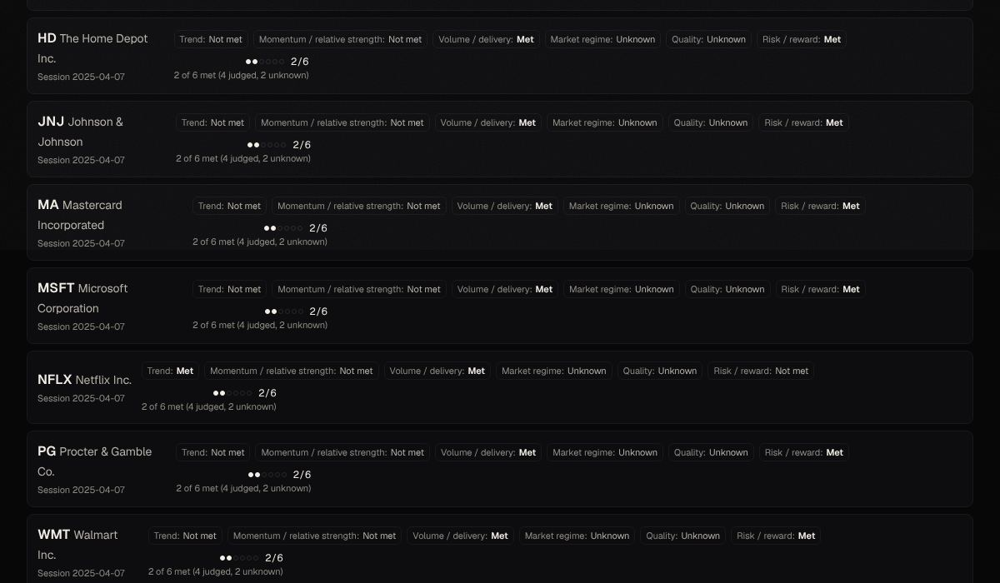

*/checklist at 1440 px: every card repeats the six names.*

**Fix.** A matrix: a sticky header names the six dimensions once; one row per symbol with a shape and a word per status (filled disc met, ring not met, dashed ring unknown); rows still expand to formulas and grades.

### C15 · Markets is mostly rows of dashes

P1 · effort S · `app/(product)/markets/page.tsx, lib/markets-table.ts`

**Evidence.** 136 of 161 rows have no stored close. The 25 with data sit in a table 8,525 px tall (17,664 px on a phone). Round 1 sorted them first; the page is still long.

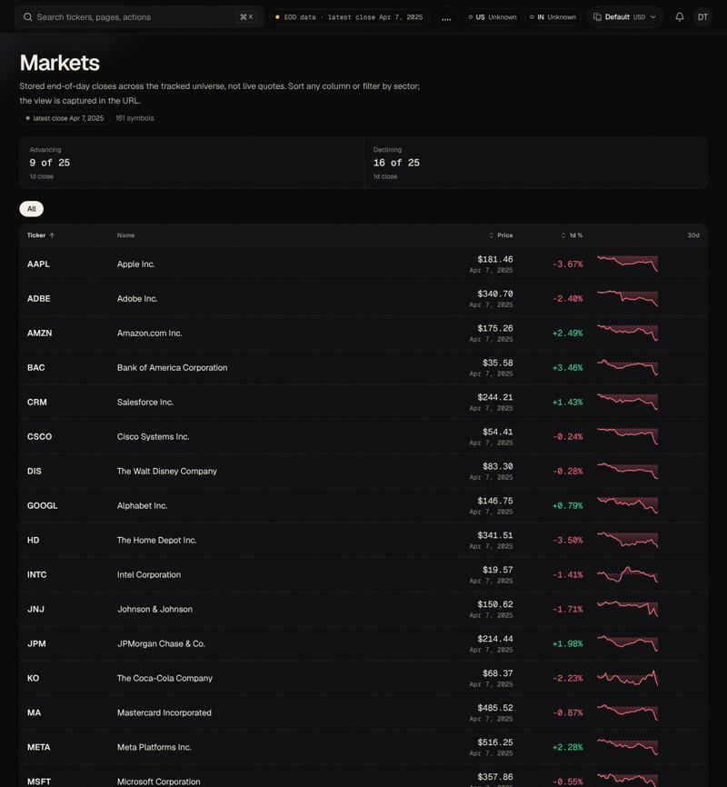

*/markets at 1440 px.*

**Fix.** Once any row has a close, leave out rows with none and add a link, "Show N more without stored closes", to `?history=all`; sorting and sector chips keep it.

### C16 · Morning Brief wastes half the screen

P2 · effort S · `app/(product)/(authed)/brief/page.tsx`

**Evidence.** Open plans and pending orders are one underlined line; the same two close dates repeat on every move row; half the desktop is empty.

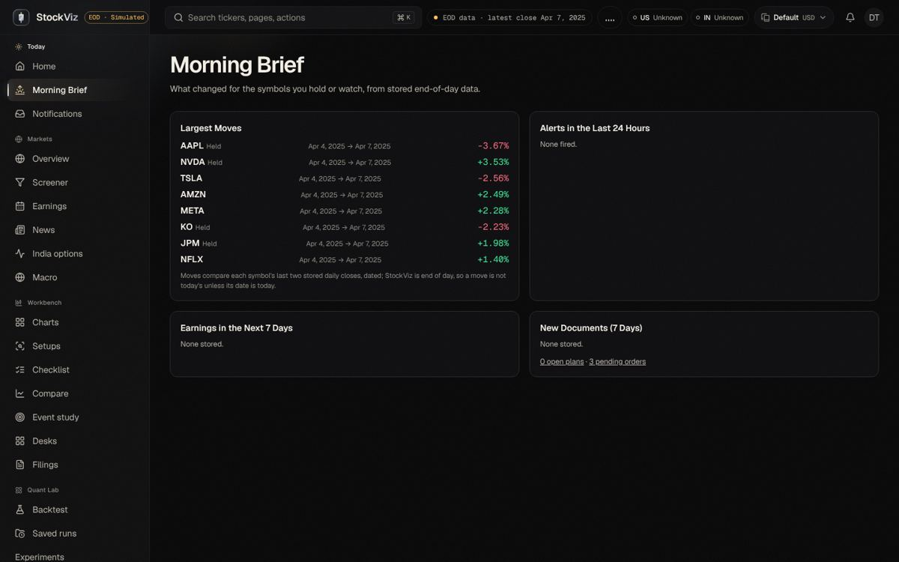

*/brief at 1440 px.*

**Fix.** A strip of six counts as links, then Largest Moves as diverging bars with the dates once in the heading; alerts, earnings and documents beside it.

### C17 · Dashboard hero shows only two figures

P2 · effort S · `components/dashboard/portfolio-hero.tsx`

**Evidence.** Equities and available cash across 1,100 px; reserved cash, unrealized P&L and open positions are in the data but not on the page.

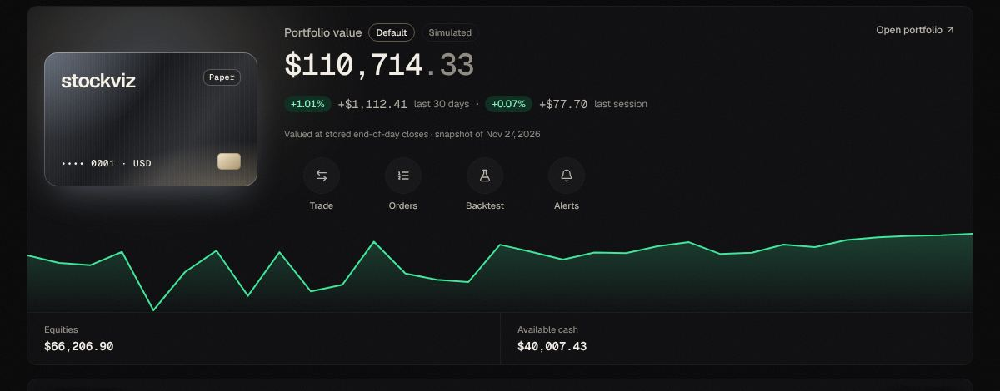

*Dashboard hero at 1440 px.*

**Fix.** A composition bar in neutral metal shades (equities, options, available cash, reserved by orders) and three more figures in the strip.

### C18 · Screener runs 5 px off a phone

P2 · effort S · `components/symbol-card-list.tsx:93-98`

**Evidence.** At 390 px the page is 395 px wide: `truncate` sits on an inline `dd`, so "United States" overflows.

**Fix.** Metric row `flex min-w-0`, label `shrink-0`, value `min-w-0 truncate`.

### C19 · Notifications has two homes

P2 · effort S · `components/operational-page-header.tsx:28, lib/app-navigation.ts`

**Evidence.** It sits under Today in the sidebar, but its page shows a tab strip with Watchlist and Alerts from Portfolio & Tax.

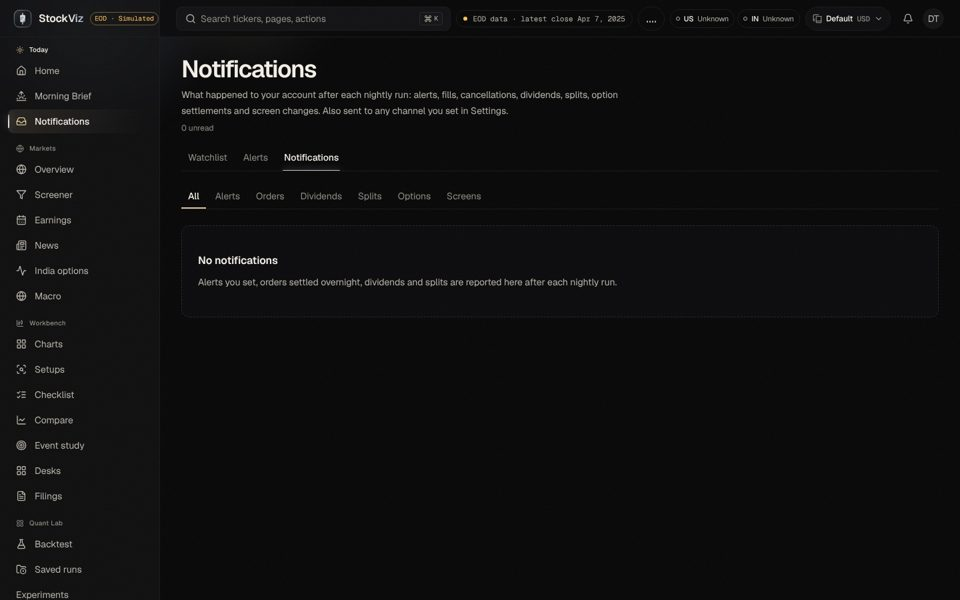

*/notifications at 1440 px.*

**Fix.** Drop the tab strip on /notifications and keep it in Today (the smaller change; the owner can choose to move it beside Alerts instead).

### C20 · Trade appears twice in the dashboard shortcuts

P3 · effort S · `components/dashboard`

**Evidence.** Markets, Research, Trade, Portfolio, then Trade, Orders, Backtest, Alerts.

**Fix.** Left as is: the owner kept the tiles on 27 Nov 2026.

## Research

Awwwards refused connections from the audit environment, so award details come from round-ups and case studies, linked below.

### How do dense products keep 30+ pages easy to find?

- [Koyfin, release v3.87](https://www.koyfin.com/help/release-notes/customizable-left-navigation/): May 2026. Favourites pinned at the top of the left nav, sections that collapse by clicking their name, drag to reorder, saved automatically.
- [Linear, personalised sidebar](https://linear.app/changelog/2024-12-18-personalized-sidebar): Dec 2024. Reorder items, hide rarely used ones under "More", unread shown as a count or a dot.
- [Linear, UI refresh](https://linear.app/changelog/2026-03-12-ui-refresh): Mar 2026. "Navigation sidebars are slightly dimmer", so the content stands out.
- [Bloomberg Terminal UX](https://www.bloomberg.com/company/stories/how-bloomberg-terminal-ux-designers-conceal-complexity): Thousands of functions; the stated rule is "We're hiding complexity". Changes roll out gradually, old and new side by side.

**What StockViz takes:** Folding workspaces that show their page counts, Today and the current workspace open, a sidebar one step dimmer than the content, and ⌘K as the fast path for everything else.

### What should a page show before it has data?

- [Stripe Apps, empty state pattern](https://docs.stripe.com/stripe-apps/patterns/empty-state): Say why it is empty and give one next step; description under 14 words; a filtered-empty state says "No results match your filters" with Clear filters.
- [SaaSFrame, empty state examples](https://www.saasframe.io/blog/saas-empty-state-design-examples): Sep 2026. Four causes need different copy: first use, no results, all done, no access. The button names an outcome. Setup states need a way to tell "no data yet" from "setup failed".

**What StockViz takes:** Split "nothing here yet" (the user's next step) from "not set up on this server" (the owner's job). First-use pages start from a one-click example with real symbols and show a preview of the result.

### How do pro trading tools let people shape their workspace?

- [Robinhood Legend, layouts](https://robinhood.com/us/en/support/articles/layouts-on-legend): Start from scratch or a template; up to nine layouts as tabs; widgets resize, link across layouts and save automatically.
- [Robinhood drops confetti](https://www.cnbc.com/2021/03/31/robinhood-gets-rid-of-confetti-feature-amid-scrutiny-over-gamification.html): CNBC, 2021. Celebration effects on trades drew regulator scrutiny.

**What StockViz takes:** Desks can become saved starting layouts for Charts, which already links panes by colour. Keep outcomes calm: no confetti, the fill sound stays short.

### What are award-winning sites doing with dark, metal and motion?

- [Lando Norris, Site of the Year](https://hireadrian.com/award-winning-websites/): By OFF+BRAND. Oversized type and scroll storytelling (round-ups date it 2025 or 2026).
- [Bruno Simon, Site of the Month](https://www.spinxdigital.com/blog/best-website-design/): Jan 2026. A Three.js world you drive through, with spatial audio.
- [Noomo, Site of the Day 2026](https://hireadrian.com/award-winning-websites/): One WebGL scene, one headline, a full-screen menu.
- [Victor Furuya '26 and Studio Namma](https://hireadrian.com/award-winning-websites/): SOTD 2026. Numbered navigation; a dark mode switch kept in the header.
- [Igloo Inc, Site of the Year 2024](https://awwwards.com/igloo-inc-case-study.html): WebGL scenes with sound synced to particles (round 1).
- [Oryzo by Lusion, Site of the Month](https://oryzo.ai/): Apr 2026. One hero object, restrained type, heavy polish (round 1).

**What StockViz takes:** One WebGL moment per page, like the liquid chrome hero and the terrain, and calm product pages. Type carries the drama. Text never sits on a busy canvas without a fade.

## Not verified

- Every "today" image is a Playwright capture of `dev` 0909e55 run locally with the demo seed. Reference "after" shots for C14–C17 come from closed, unmerged PR #114.
- 3D and some chart canvases were seen only in headless Chromium; check them on a real GPU and phone.
- No screen-reader pass; labels were checked in the DOM only.
- India options was empty locally (no option files); its images are mockups.
- Round 1 findings F6 (landing targets under 24 px), F8 (Alerts half-width) and F10 (one-line empty states) were not re-checked.
