# StockViz new changes to build

Round 2 of the UI redesign, in the **Liquid Chrome** palette (dev 0909e55, 27 Nov 2026). Design only: each change has today's screen, the proposed design, what stays, and a build note with files and a "done when" check. Everything not listed stays as it is on `dev`.

Live page with the same content: https://claude.ai/artifact/SWMK7yepqQxgsnfYbNYgoQ (private to the owner until shared).

Severity: P1 major, P2 minor, P3 polish. Effort: S under a day, M a few days.

## Rules for every change

- Liquid Chrome tokens only. Brand champagne for identity, focus and selection; gain and loss only through `--positive` and `--negative`.
- Labels in Title Case via `titleCase()`, never capitals. Status as a shape and a word, never colour alone.
- One-shot motion that settles, off with reduced motion. `localStorage` reads and writes in try/catch; the page works without it.
- Run `pnpm lint && pnpm typecheck && pnpm build` and the web unit tests; check each page at 390 and 1440 px.

C14 to C20 come from the second audit of the signed-in pages (C20, Trade twice in the dashboard shortcuts, is left as is by the owner's choice). A reference first pass of M1, C14–C17 and the Copilot and method-note parts of M3/M6 exists on closed, unmerged PR #114; these notes are the spec.

## Build order

| # | Change | Severity | Effort | Note |
|---|---|---|---|---|
| 1 | [M1](#m1) Navigation and top bar | P1 | M | Every page benefits; closes C1 and C5 |
| 2 | [C15](#c15) Markets: fold rows without closes | P1 | S | The longest table |
| 3 | [C14](#c14) Checklist as a matrix | P1 | M | The longest page |
| 4 | [M3](#m3) “Not set up” state and method notes | P1 | S | Removes developer text; closes C2 |
| 5 | [M6](#m6) Copilot that starts with a question | P1 | S | Uses the M3 setup state |
| 6 | [C18](#c18) Screener 5 px off a phone | P2 | S |  |
| 7 | [L1](#l1) Landing: “Everything in the workspace” | P2 | S–M | Owner asked for it; landing only |
| 8 | [M2](#m2) First-use pattern (20 empty pages) | P1 | M | Start with Pairs Lab; closes C3 and C4 |
| 9 | [C16](#c16) Morning Brief counts and moves | P2 | S |  |
| 10 | [C17](#c17) Dashboard hero composition | P2 | S |  |
| 11 | [C7](#c7) Dashboard line scale | P2 | S | Same card as C17 |
| 12 | [M4](#m4) Screener rule in the open | P2 | M | Closes C8 |
| 13 | [M5](#m5) Phone tabs and More sheet | P2 | M | Closes C13 |
| 14 | [C19](#c19) Notifications: one home | P2 | S |  |
| 15 | [C6](#c6) One row of tabs on Quant Lab | P2 | S |  |
| 16 | [C9](#c9) Terrain sentence readable | P2 | S | Landing |
| 17 | [C10](#c10) Compare in chrome colours | P3 | S |  |
| 18 | [C11](#c11) Range chips for dates | P3 | S |  |
| 19 | [C12](#c12) Missing space on the dashboard | P3 | S |  |

---

## L1

**Landing: "Everything in the workspace"** · P2 · effort S–M · landing page only

Scope: only this one section changes. The hero, terrain, movers, session tiles, proof rows, story, fill steps, statement band, marquee, FAQ and closing call to action stay exactly as they are.

| Today, desktop 1440 | Proposed, desktop 1440 (Markets in hover state) |
|---|---|
| 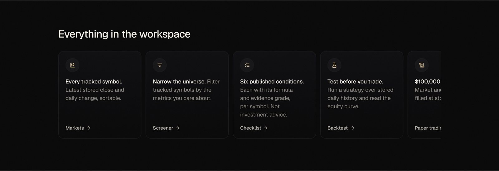 | 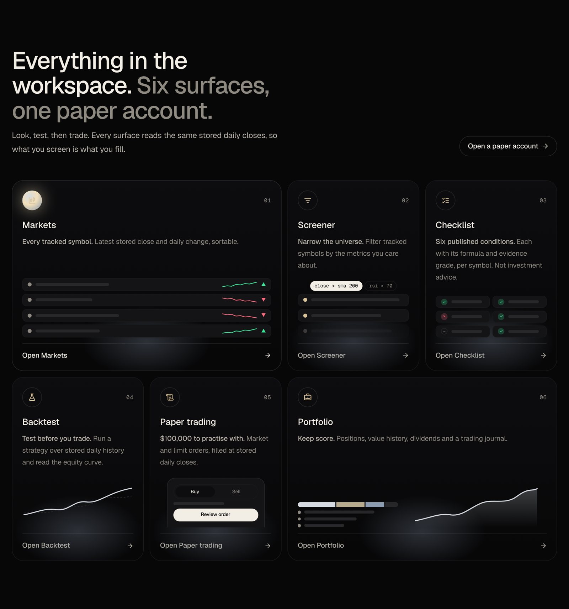 |

| Today, phone 390 | Proposed, phone 390 |
|---|---|
| 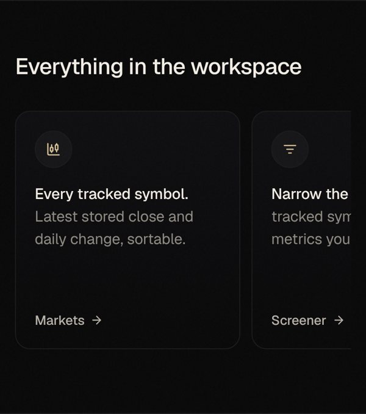 | 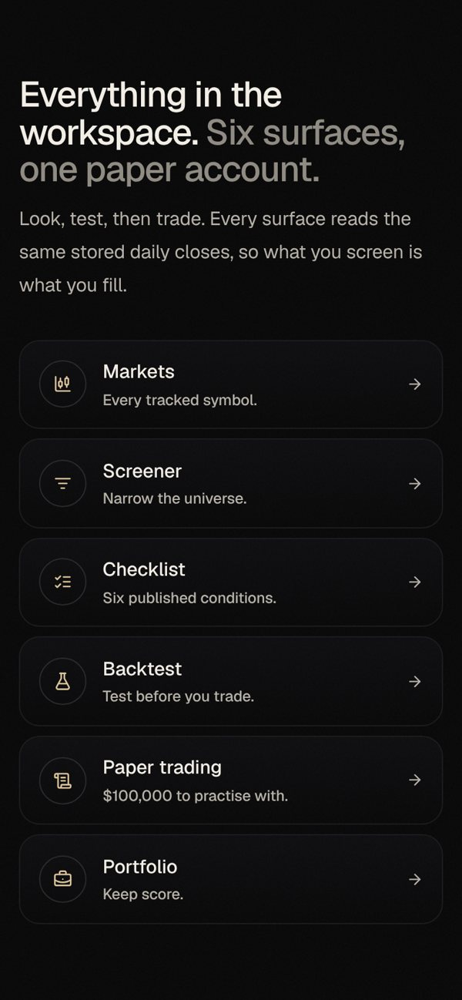 |

**Why it looks out of place today**

- Heading is a size smaller: 30 px single tone, while every other section uses the 48 px two-tone `SectionHead` ("Every fill shows its work. Nothing happens off screen.").
- It scrolls sideways, with a visible scrollbar and a cut-off tile. No other landing section scrolls inside a box.
- Tiles have no picture. The session tiles and fill steps above each carry a small illustration.
- Different card style: 16 px radius and border lines above and below the section, where its neighbours use 24 px cards and no section rules.
- No intro line and no next step, so it reads as a footer sitemap rather than a section.

**What changes**

- Heading uses `SectionHead`: "Everything in the workspace." with the soft half "Six surfaces, one paper account." and one intro line.
- Bento grid, 4 columns: Markets and Portfolio span two; Screener, Checklist, Backtest and Paper trading span one. All six visible at once.
- Each tile gets the session-tile card, a round icon that lights in chrome on hover (as in fill steps), a small figure-free illustration and an "Open …" footer.
- Phone: tiles become compact rows (icon, name, lead, arrow).
- One outlined pill, "Open a paper account" (the hero's label), at the right of the heading on desktop, like "Open markets" in the movers section.

**What stays:** the same six surfaces, links, icons, and lead and detail text word for word; one stretched link per tile; "Not investment advice." on Checklist; the position after the marquee and before the FAQ.

**Why this design:** it uses only patterns already on the landing page (two-tone heading, session-tile card and glow, the fill-steps chrome orb, the outlined pill), so it cannot look foreign. Illustrations carry no numbers, following the rule written above `SessionTiles`. A mixed-width grid is the usual way product sites show "what's inside" in one view (general knowledge; Awwwards could not be opened from the design environment).

**Build note**

1. **Move the section into the shared file.** Cut the `<section aria-labelledby="surfaces-heading">` block and the `SURFACES` array out of `apps/web/app/(public)/page.tsx` (lines 44–93 and 111–154 on `dev` 0909e55) into a new `export function WorkspaceTiles()` in `apps/web/components/marketing/landing-sections.tsx`, so it can use the file's `Wrap` and `SectionHead`. Render `<WorkspaceTiles />` where the section was.
2. **Heading.** `<SectionHead title="Everything in the workspace." soft="Six surfaces, one paper account.">` with the body "Look, test, then trade. Every surface reads the same stored daily closes, so what you screen is what you fill." Keep `id="surfaces-heading"` on the `h2` (add an optional `id` prop to `SectionHead`). Put the heading and an outlined pill `Link href="/signup"` "Open a paper account" in a `flex flex-wrap items-end justify-between gap-8` row; hide the pill below `sm`.
3. **Grid.** Drop `border-y` and the scroll row. `<ul data-motion="rise" className="mt-12 grid gap-3 sm:grid-cols-2 lg:grid-cols-4">`; Markets and Portfolio get `lg:col-span-2`.
4. **Tile (sm and up).** Reuse the session-tile classes: `relative grid min-h-76 grid-rows-[auto_auto_1fr_auto] gap-2 overflow-hidden rounded-3xl border border-border-muted bg-linear-to-b from-card to-background p-5` plus `group spotlight`. Icon in a `size-10 rounded-full border border-border` orb; on `group-hover`/`group-focus-within` give it the fill-steps lit classes (radial `--brand-gradient-*` fill and glow) with `text-primary-foreground` so the icon stays readable. Then the `h3` label, the lead (`text-text-secondary font-medium`) and detail (`text-text-tertiary`), the art (`aria-hidden`, `brand-glow` behind it), and a footer row (`border-t border-border-muted pt-3`) with "Open {label}" and the arrow. The label `Link` keeps its `after:absolute after:inset-0` stretch.
5. **Art, no figures.** Markets: four rows with a grey name bar and a small green or red sparkline with ▲/▼. Screener: chips `close > sma 200` and `rsi < 70` over three rows, the last faded. Checklist: six rows in two columns with pass, fail or neutral marks. Backtest: a strategy curve in `--brand-gradient-to` over a dashed buy-and-hold line. Paper trading: a small order sheet with Buy/Sell and a "Review order" pill. Portfolio: a four-part allocation bar and a filled value line. Reuse `landing-draw` and `landing-filter-out`; they already stop with reduced motion.
6. **Phone (below sm).** Each tile becomes `grid grid-cols-[auto_1fr_auto] items-center gap-3 rounded-2xl p-4`; hide the art, the detail and the "Open" word (`max-sm:hidden`); keep icon, label, lead and arrow.
7. **Docs.** Update the section-order comment at the top of `page.tsx` to name `WorkspaceTiles`.

**Done when**

- [ ] At 1440 px all six tiles are visible with no scrollbar; two rows (2+1+1, then 1+1+2) whose edges line up with the FAQ below.
- [ ] At 390 px the section shows six rows of about 72 px, and `document.documentElement.scrollWidth` is 390.
- [ ] The heading renders at the same size and two tones as "Every fill shows its work."
- [ ] Hovering or tabbing to a tile lights its icon, and the icon stays readable.
- [ ] Each tile is one link, announced as "Markets, link" and so on, with a visible focus ring.
- [ ] No illustration shows a price, percentage or date.
- [ ] `pnpm lint && pnpm typecheck && pnpm build` pass.

---

## M1

**Navigation and top bar** · P1 · effort M

| Today | Proposed |
|---|---|
| 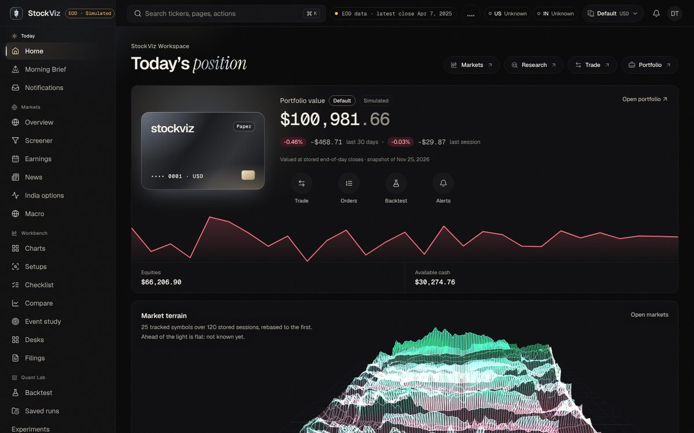 |  |

**Audit findings this closes**

- **C1 · The sidebar no longer fits the screen.** 36 pages under six workspace headings are always open. At 1440 × 900 the list stops at "Experiments"; Portfolio & Tax, AI Copilot, Status and Settings are below the fold. Four items have no icon (Experiments, Pairs lab, Import tradebook, Theses) and three pairs share one (Markets and Macro, Charts and Desks, India options and News reactions).
- **C5 · The top bar has eight controls and two say "Unknown".** Search, data date, sound (four dots, no word), US regime "Unknown", India regime "Unknown", book, bell, avatar. "Unknown" reads like an error.

**Today.** 36 pages always open; AI Copilot, Status and Settings below the fold; items without icons or sharing one. Eight controls in the top bar, two reading "Unknown".

**What changes.** Today and the current workspace open; every other workspace folded to its page count; every item its own icon; Status and Settings at the bottom; a Market Pulse card (the landing page close line, small) at the foot. Top bar: search, data date, book, sound, bell, avatar; regime chips only when known.

**What stays.** Every route and its workspace, the ⌘K palette, the data-date chip, the book switcher.

**Why.** Linear and Koyfin both solved a long sidebar with sections that fold; Linear dims the sidebar so content leads. Market Pulse gives the inside and the landing page one picture of the market.

**Build note**

```
FILES   components/app-navigation.tsx, components/navigation-icons.ts,
        components/sidebar-pulse.tsx (new), components/app-sidebar.tsx,
        components/app-shell.tsx, components/regime-popover.tsx:43
DO      Workspace headings become buttons (aria-expanded,
        aria-controls) that fold to a count pill. Open by default:
        Today + the current route's workspace, which can't close.
        Reader's choice in localStorage stockviz:nav-open, guarded.
        One lucide icon per item (unit test: none shared, none missing).
        Market Pulse reuses loadTerrain() and lib/footer-market.ts;
        renders nothing when data is too thin.
        Regime chips render only for a known regime.
DONE WHEN  At 1440 x 900 every workspace heading, Status and Settings
        are visible without scrolling; reload keeps open groups;
        Market Pulse reads "25 Symbols · 120d · Apr 7, 2025" on the seed;
        no "Unknown" chip shows on the seed.
```

---

## M2

**First-use pattern, shown on Pairs lab** · P1 · effort M

| Today | Proposed |
|---|---|
| 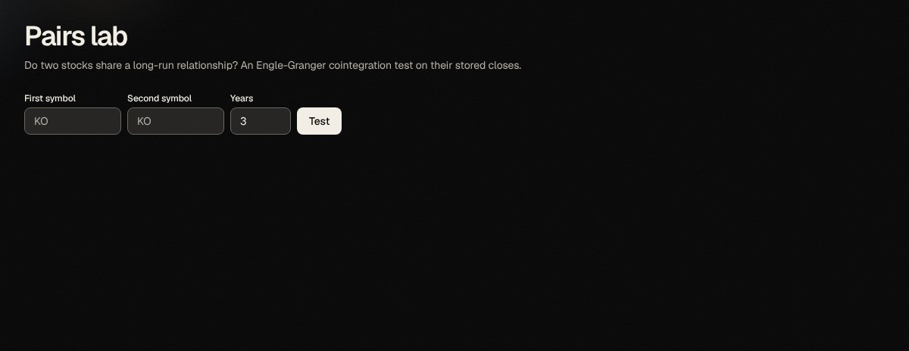 | 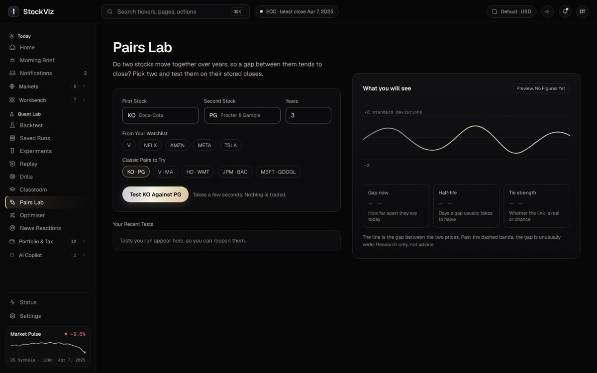 |

**Audit findings this closes**

- **C3 · Half the new pages open empty.** 20 of 41 signed-in pages open on a dashed box with one sentence (filter "Empty first" in the gallery). None shows what the result will look like, and only some offer a starting example.
- **C4 · Form pages use half the screen.** On Copilot, Classroom, Pairs lab, Theses, Filings, Notifications, Desks, Compare and Backtest the content stops near the middle; a third or more of a 1440 px screen is empty.

**Today.** Two empty fields and a Test button. Nothing says what a result looks like.

**What changes.** Pairs from your watchlist and classic pairs to try (all in the 25 stored symbols), one button that names the test, a preview of the result with each figure explained, and recent tests.

**What stays.** The same inputs and the same test; nothing is run until you press the button.

**Why.** Stripe and SaaSFrame: say what the page is for, name the outcome, and make the first run one click.

**Build note**

```
FILES   components/first-run.tsx (new, shared), app/(product)/pairs/page.tsx
        then optimise, event-study, news-reactions, classroom, drills,
        theses, backtest/runs, backtest/experiments
DO      FirstRun = { examples: chips from the watchlist + fixed pairs,
        preview: static SVG + labelled figure slots, recent: last 5 }.
DONE WHEN  /pairs shows KO · PG preselected and "Test KO against PG";
        no preview slot shows a number before a run.
```

---

## M3

**"Not set up on this server", shown on India options** · P1 · effort S

| Today | Proposed |
|---|---|
| 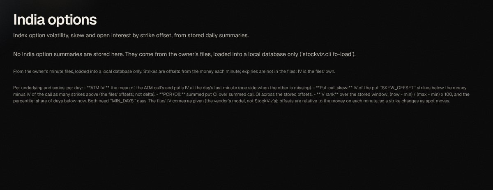 | 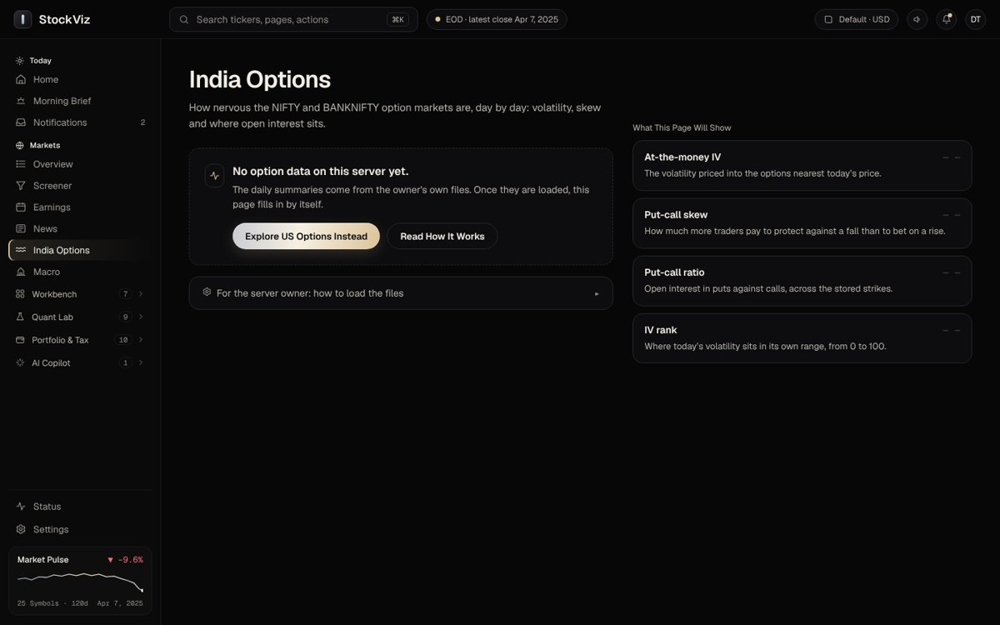 |

**Audit findings this closes**

- **C2 · Developer instructions are shown to users.** India options prints the API module docstring as text, with raw Markdown (`**ATM IV:**`, ```SKEW_OFFSET```) and a CLI command. Copilot says "set OLLAMA_MODEL". Macro and the Checklist name `stockviz.cli` commands.
- **C4 · Form pages use half the screen.** On Copilot, Classroom, Pairs lab, Theses, Filings, Notifications, Desks, Compare and Backtest the content stops near the middle; a third or more of a 1440 px screen is empty.

**Today.** A Python docstring rendered as text with raw Markdown and a CLI command.

**What changes.** One sentence for the user, a way out (US options), what the page will show once loaded, and the loading command inside a closed "For the server owner" note.

**What stays.** The method text, moved into a defined list on the loaded page.

**Why.** SaaSFrame: a setup state must tell "no data yet" apart from "broken". Users should never read an operator's instructions.

**Build note**

```
FILES   components/fo-india-view.tsx:122-123, components/macro-view.tsx,
        app/(product)/copilot/page.tsx, components/setup-state.tsx (new)
DO      SetupState = { title, sentence, action, preview list,
        ownerNote (details, closed) }. Loaded page: methodParts()
        in lib/method-text.ts splits data.method into a lead and
        label / text pairs, strips ** and backticks; render as <dl>.
DONE WHEN  No page shows *, ` or stockviz.cli outside the owner note;
        a note without a list renders as one paragraph.
```

---

## M4

**Screener with the rule built in the open** · P2 · effort M

| Today | Proposed |
|---|---|
| 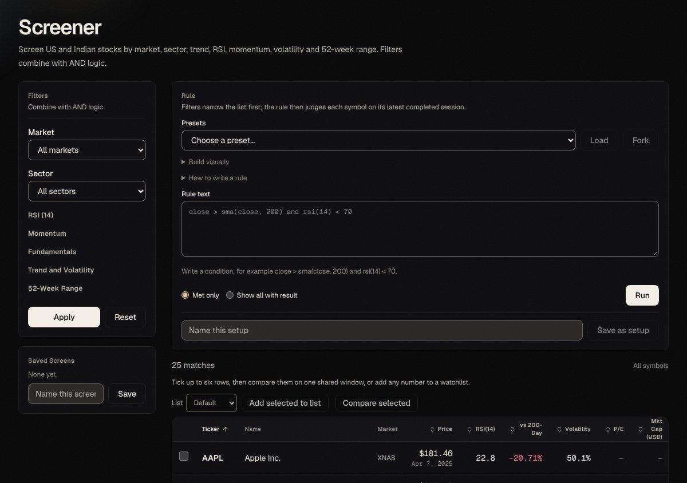 | 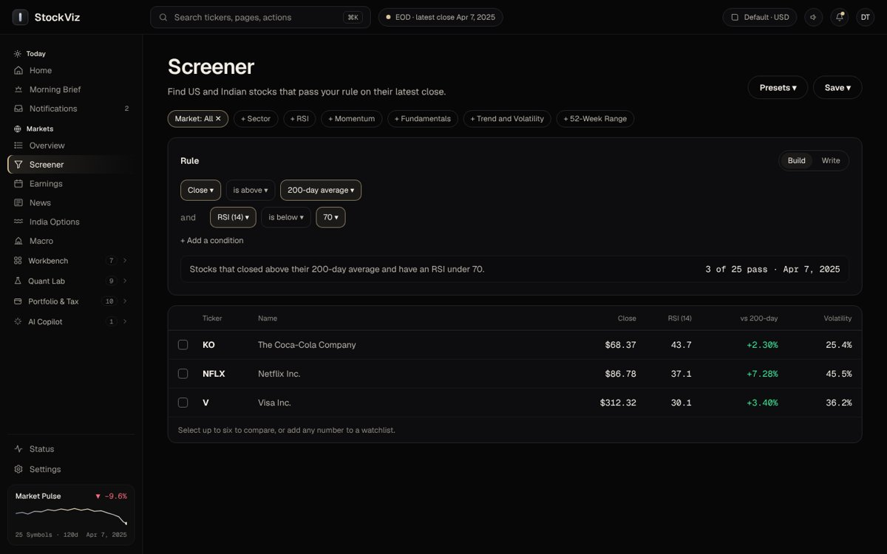 |

**Audit findings this closes**

- **C8 · The screener hides its best tool.** The visual rule builder is closed under "Build visually"; an empty rule textbox comes first; filter groups look like headings with no chevron; there are two separate "Name this …" save fields.

**Today.** The visual builder is folded away; an empty textbox leads; two separate save fields.

**What changes.** Filters as removable chips; the rule as chip rows with Build and Write modes; a live sentence and match count ("3 of 25 pass · Apr 7, 2025", the real result); one Save menu.

**What stays.** Rule text mode, presets, saved screens and setups, compare and watchlist actions.

**Why.** The rule builder is the screener's newest interaction and its biggest advantage, so it should be the first thing seen.

**Build note**

```
FILES   app/(product)/screener/page.tsx, the visual rule builder component
DO      Open the builder by default; Write toggles to the text rule.
        Count = rule.counts.met of rule.evaluated from /v1/screener.
DONE WHEN  /screener?rule=close > sma(close, 200) and rsi(14) < 70
        shows "3 of 25 pass · Apr 7, 2025" and rows KO, NFLX, V.
```

---

## M5

**Phone tabs and the More sheet** · P2 · effort M

| Today | Proposed |
|---|---|
| 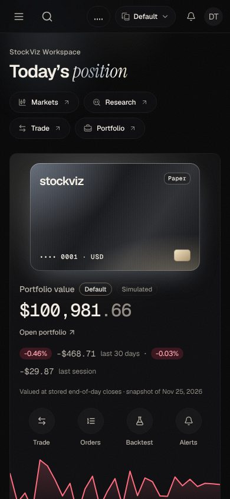 | 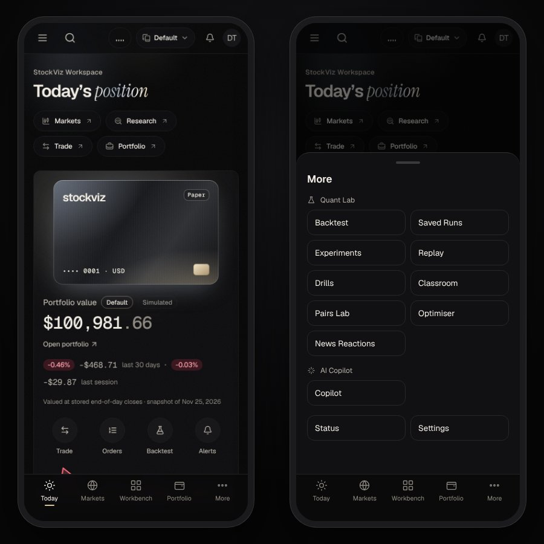 |

**Audit findings this closes**

- **C13 · Phone has no quick way between workspaces.** Every move on a phone goes through the menu button and the same 38-link list.

**Today.** Every move goes through the menu button and the 38-link list.

**What changes.** Today, Markets, Workbench, Portfolio and More in a bottom bar; More opens a sheet with Quant Lab, Copilot, Status and Settings as large targets.

**What stays.** The menu button and ⌘K search stay in the top bar; the stock page keeps its Buy and Sell bar above the tabs.

**Why.** The four most used workspaces one tap away; everything else two taps.

**Build note**

```
FILES   components/app-mobile-nav.tsx, components/app-shell.tsx
DO      Bar under md only, 78 px with safe-area padding; pages add
        bottom padding so nothing hides under it. More = sheet.
DONE WHEN  At 390 px every page is two taps from any other;
        targets are at least 44 x 44.
```

---

## M6

**Copilot that starts with a question** · P1 · effort S

| Today | Proposed |
|---|---|
| 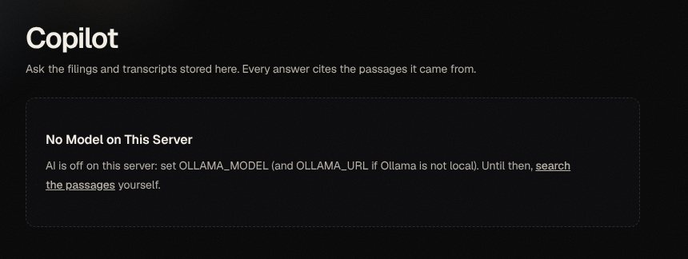 | 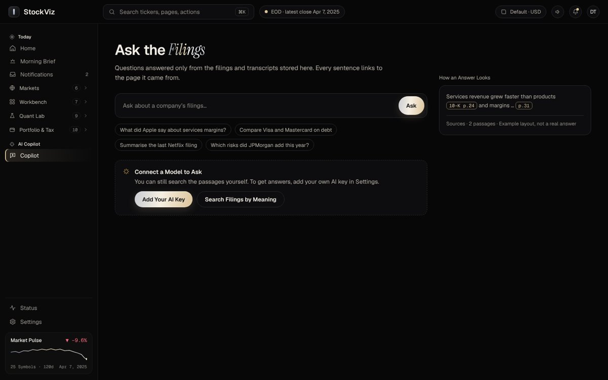 |

**Audit findings this closes**

- **C2 · Developer instructions are shown to users.** India options prints the API module docstring as text, with raw Markdown (`**ATM IV:**`, ```SKEW_OFFSET```) and a CLI command. Copilot says "set OLLAMA_MODEL". Macro and the Checklist name `stockviz.cli` commands.
- **C4 · Form pages use half the screen.** On Copilot, Classroom, Pairs lab, Theses, Filings, Notifications, Desks, Compare and Backtest the content stops near the middle; a third or more of a 1440 px screen is empty.

**Today.** "No Model on This Server" and an environment variable.

**What changes.** An ask box, example questions, a "Connect a Model to Ask" note with two ways forward (Add Your AI Key, Search Filings by Meaning), and how a cited answer looks. The server's reason moves to a small "Server note".

**What stays.** Answers only from stored passages; the search-passages path; BYOK keys in Settings.

**Why.** The copilot's promise is citations; showing the citation chip before the first answer sets that expectation.

**Build note**

```
FILES   app/(product)/copilot/page.tsx, components/citation-chip.tsx (new)
DO      Primary .prism-cta "Add Your AI Key" -> /settings#ai-keys-heading;
        secondary "Search Filings by Meaning" -> /filings?match=meaning.
        Example questions use symbols with stored filings only;
        the preview card is labelled as an example.
DONE WHEN  With no model, the main text names no environment
        variable and the button lands on the AI Keys panel.
```

---

# Page fixes

## C15

**Markets is mostly rows of dashes** · P1 · effort S

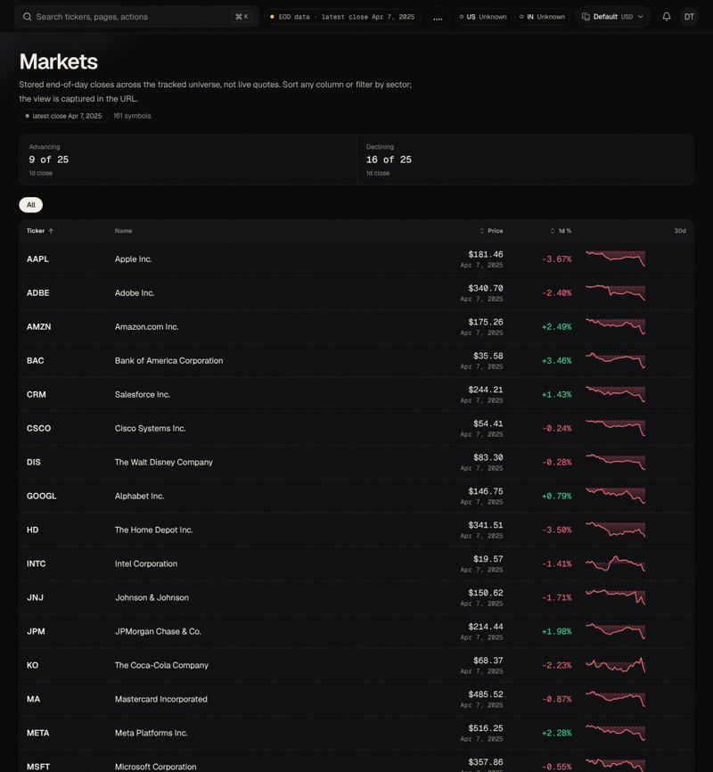

*Today: /markets at 1440 px.*

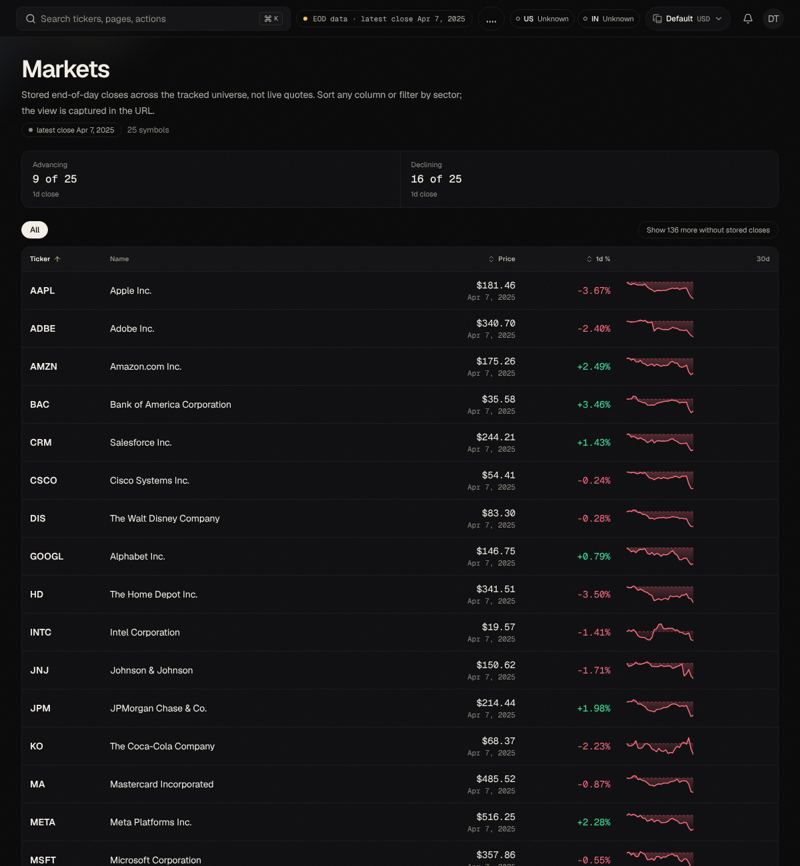

*Proposed: Reference build: 25 rows with data and a link to show the rest (closed PR #114, for reference).*

**Today.** 136 of 161 rows have no stored close. The 25 with data sit in a table 8,525 px tall (17,664 px on a phone). Round 1 sorted them first; the page is still long.

**Change.** Once any row has a close, leave out rows with none and add a link, "Show N more without stored closes", to `?history=all`; sorting and sector chips keep it.

**Files.** `app/(product)/markets/page.tsx, lib/markets-table.ts`

**Done when.** The default view lists only symbols with a stored close; the link shows the exact count of hidden rows; `?history=all` restores the full table; breadth figures are unchanged; /markets at 1440 px is under 3,000 px tall on the seed.

---

## C14

**Checklist repeats 966 labels and is 17,167 px tall** · P1 · effort M

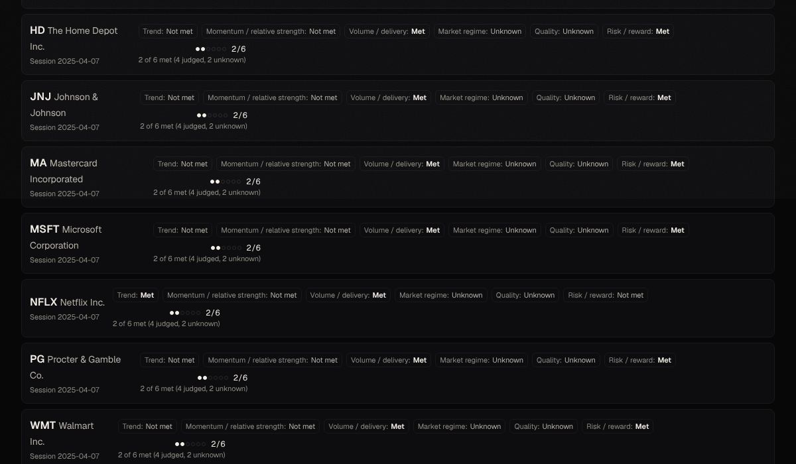

*Today: /checklist at 1440 px: every card repeats the six names.*

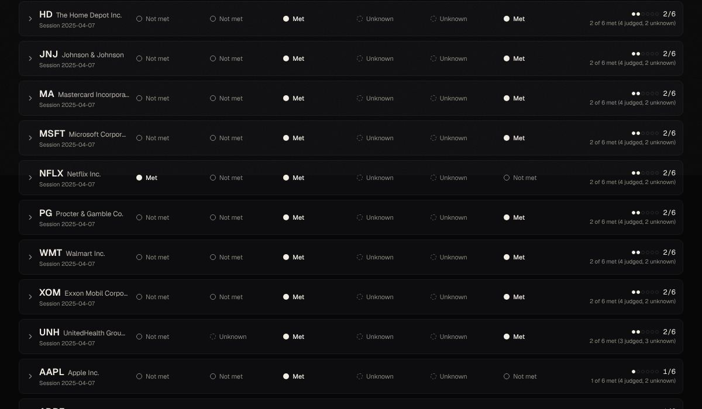

*Proposed: Reference build: one row per symbol under a sticky header (closed PR #114, for reference).*

**Today.** 161 cards each write out all six dimension names. The page is 17,167 px on desktop and 34,816 px on a phone.

**Change.** A matrix: a sticky header names the six dimensions once; one row per symbol with a shape and a word per status (filled disc met, ring not met, dashed ring unknown); rows still expand to formulas and grades.

**Files.** `app/(product)/checklist/page.tsx, components/checklist/checklist-view.tsx`

**Done when.** Desktop page under 12,000 px and phone under 13,000 px on the seed; status never depends on colour alone (shape plus word, visible or sr-only); the checklist unit test still bans buy and sell words; `min`, `dimension`, `sort` and `q` URL state behave as before.

---

## C18

**Screener runs 5 px off a phone** · P2 · effort S

**Today.** At 390 px the page is 395 px wide: `truncate` sits on an inline `dd`, so "United States" overflows.

**Change.** Metric row `flex min-w-0`, label `shrink-0`, value `min-w-0 truncate`.

**Files.** `components/symbol-card-list.tsx:93-98`

**Done when.** No horizontal scroll on /screener and /markets at 320, 360 and 390 px.

---

## C16

**Morning Brief wastes half the screen** · P2 · effort S

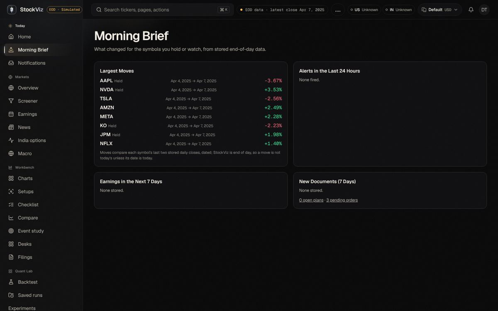

*Today: /brief at 1440 px.*

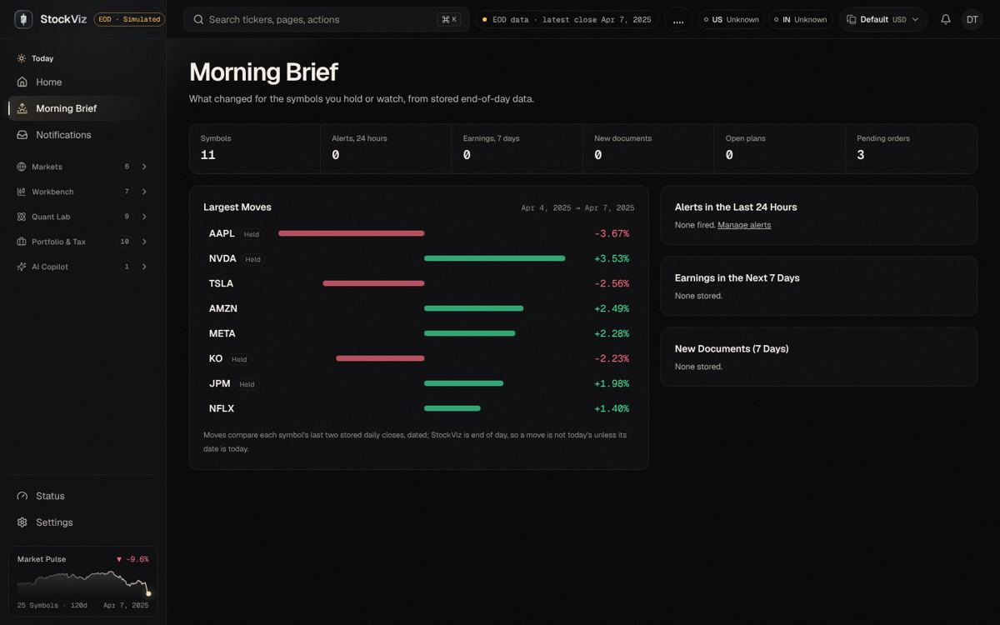

*Proposed: Reference build: counts strip and diverging bars (closed PR #114, for reference).*

**Today.** Open plans and pending orders are one underlined line; the same two close dates repeat on every move row; half the desktop is empty.

**Change.** A strip of six counts as links, then Largest Moves as diverging bars with the dates once in the heading; alerts, earnings and documents beside it.

**Files.** `app/(product)/(authed)/brief/page.tsx`

**Done when.** Every count links to its page; when all rows share dates they appear once in the heading; the plans and orders sentence stays for screen readers.

---

## C17

**Dashboard hero shows only two figures** · P2 · effort S

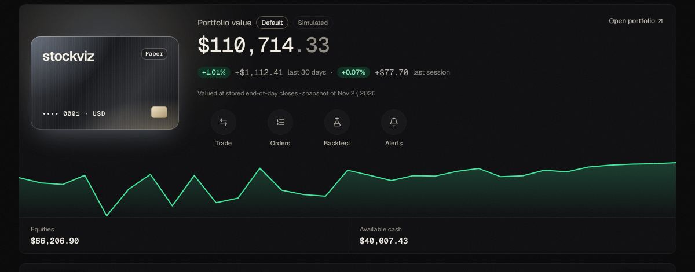

*Today: Dashboard hero at 1440 px.*

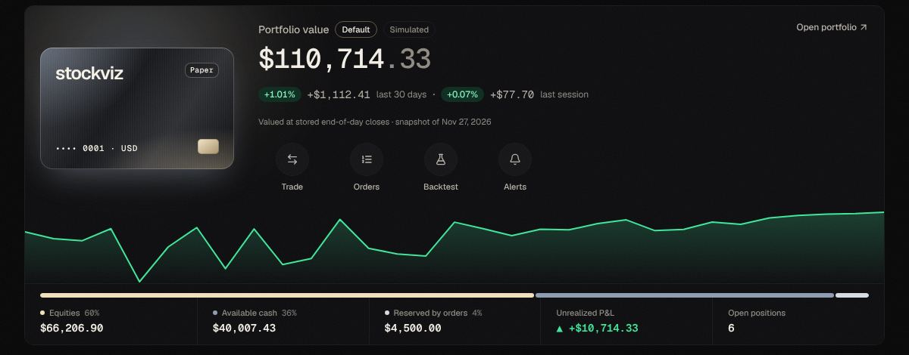

*Proposed: Reference build: composition bar and five figures (closed PR #114, for reference).*

**Today.** Equities and available cash across 1,100 px; reserved cash, unrealized P&L and open positions are in the data but not on the page.

**Change.** A composition bar in neutral metal shades (equities, options, available cash, reserved by orders) and three more figures in the strip.

**Files.** `components/dashboard/portfolio-hero.tsx`

**Done when.** The composition parts sum to the value; the bar uses neutral metal shades only; unrealized P&L shows sign, arrow and colour.

---

## C7

**A quiet month looks like a crash** · P2 · effort S

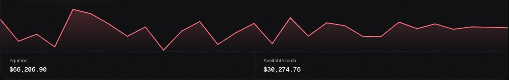

*Today: Dashboard hero line, 30 days, −$468.71.*

**Today.** The dashboard line spans its full height for a −0.46% month, with no axis or baseline, so a 0.5% wobble reads as a collapse.

**Change.** Draw a baseline at the starting value, give the range at least ±2%, and label the first and last value.

**Files.** `components/dashboard/nav-sparkline.tsx`

**Done when.** For the demo account’s −0.46% month the line fills no more than about a quarter of the chart height, a baseline marks the starting value, and the first and last values are labelled.

---

## C19

**Notifications has two homes** · P2 · effort S

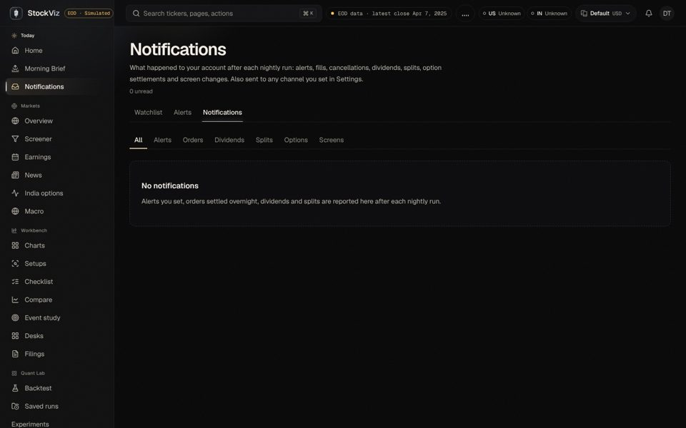

*Today: /notifications at 1440 px.*

**Today.** It sits under Today in the sidebar, but its page shows a tab strip with Watchlist and Alerts from Portfolio & Tax.

**Change.** Drop the tab strip on /notifications and keep it in Today (the smaller change; the owner can choose to move it beside Alerts instead).

**Files.** `components/operational-page-header.tsx:28, lib/app-navigation.ts`

**Done when.** /notifications shows no Watchlist / Alerts tab strip and stays under Today in the sidebar.

---

## C6

**Two rows of tabs on Quant Lab pages** · P2 · effort S

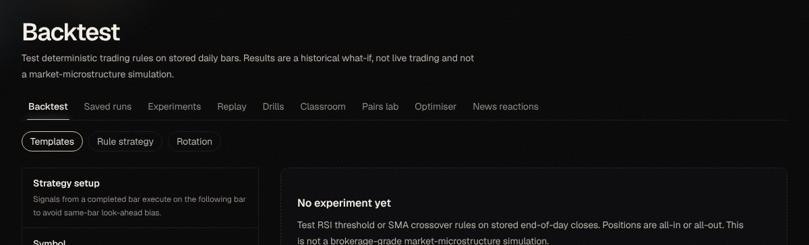

*Today: /backtest at 1440 px.*

**Today.** Backtest shows nine workspace tabs (Backtest, Saved runs … News reactions) above its own three mode tabs. The nine repeat the sidebar.

**Change.** Hide the workspace subnav from `lg` up, where the sidebar shows the same links; keep it on phone and tablet.

**Files.** `components/research-page-header.tsx:27`

**Done when.** At 1440 px /backtest shows one row of tabs (its three modes). At 390 px the workspace tabs still show.

---

## C9

**The terrain sentence sits on the mesh** · P2 · effort S

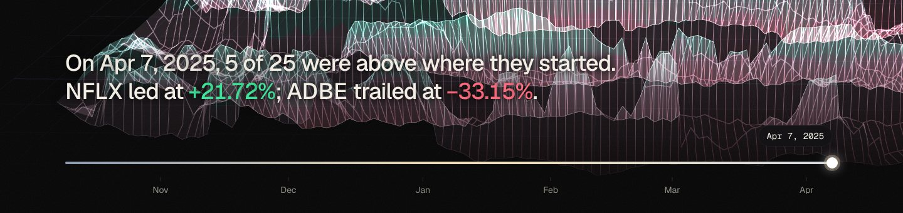

*Today: Landing, "fourth axis" section.*

**Today.** The landing sentence "On Apr 7, 2025, 5 of 25 were above where they started" is drawn straight over bright wireframe peaks.

**Change.** Fade the canvas behind the text band with `mask-image` on the host (overlays break the WebGL layer), or move the sentence under the canvas.

**Files.** `components/prism/terrain-section.tsx`

**Done when.** The terrain sentence keeps at least 4.5:1 contrast against what is behind it at every scroll point, and the WebGL layer still renders.

---

## C10

**Compare is the only blue and violet in the app** · P3 · effort S

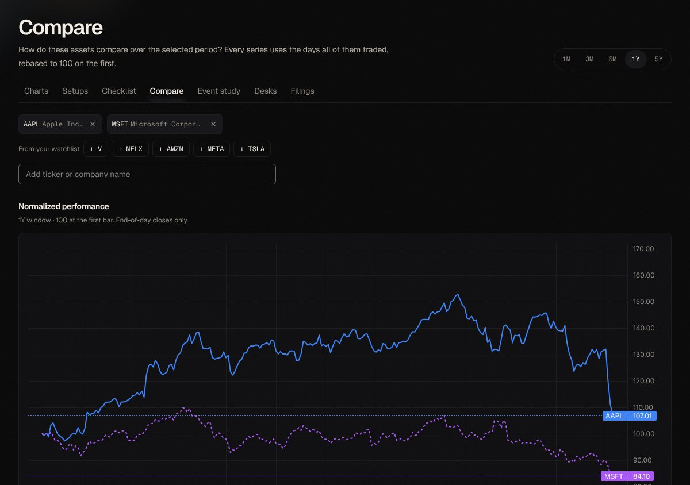

*Today: /compare?tickers=AAPL&tickers=MSFT.*

**Today.** The AAPL and MSFT lines and their tags use the categorical overlay ramp `#8277e8, #4baebd …`.

**Change.** Chrome series: pearl, champagne, steel, with the existing dash styles carrying the difference.

**Files.** `lib/chart-theme.ts:52`

**Done when.** /compare?tickers=AAPL&tickers=MSFT shows no blue or violet; the two lines differ by tone and dash.

---

## C11

**Native date fields everywhere** · P3 · effort S

**Today.** Replay, Event study, News and Backtest use the browser's mm/dd/yyyy field, which looks different on every browser.

**Change.** Range chips (1Y, 3Y, since 2020, custom) with one styled date field for custom.

**Files.** `the four forms`

**Done when.** No browser date field shows by default on Replay, Event study, News or Backtest; range chips set the dates and “Custom” opens one styled field.

---

## C12

**A missing space on the dashboard** · P3 · effort S

**Today.** The news tile reads "…watchlist yet.Market headlines".

**Change.** Add the space before the link.

**Files.** `components/dashboard/news-widget.tsx:42`

**Done when.** The dashboard news tile reads “…watchlist yet. Market headlines” with the space.

---

## How the screenshots were made

"Today" images are Playwright captures of `dev` 0909e55 run locally with the demo seed. L1's proposed images were rendered by swapping the section inside the running landing page, so fonts, colours and neighbours are real. M mockups use the app's own tokens and fonts with real stored data (25 priced symbols, latest close Apr 7, 2025); preview cards without figures are labelled as examples. New copy needs the owner's OK.
